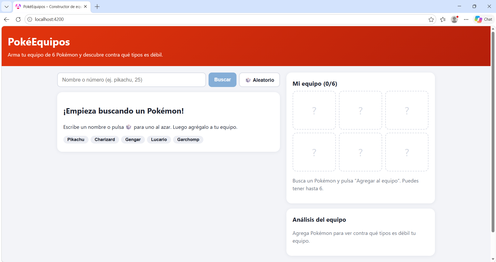

# PokéEquipos

Práctica 02 de Programación y Plataformas Web (UPS). Es una app en Angular que usa PokéAPI para armar un equipo de hasta 6 Pokémon y ver contra qué tipos queda débil.

La idea salió de algo que pasa mucho al jugar: eliges Pokémon que te gustan y después te das cuenta de que la mitad del equipo cae contra el mismo tipo. La app te avisa de eso mientras armas el equipo.

**Demo:** pendiente (link de Vercel)
**Repo:** https://github.com/DannielS110/poke-equipos



## Qué se puede hacer

- Buscar un Pokémon por nombre o número. El buscador sugiere nombres mientras escribes y también hay un botón para sacar uno al azar.
- Ver su ficha: imagen, tipos, altura, peso, descripción en español, si es legendario o mítico, y sus estadísticas base.
- Tocar un tipo para ver a qué le hace daño doble, de qué recibe daño doble, qué resiste y a qué es inmune. Desde ahí se puede saltar a otro tipo.
- Tocar una habilidad para ver qué hace.
- Agregar hasta 6 Pokémon al equipo, quitarlos o vaciarlo. El equipo se queda guardado en el navegador aunque recargues.
- Ver el análisis del equipo: para cada uno de los 18 tipos cuenta cuántos miembros son débiles, cuántos resisten y cuántos son inmunes. Si un tipo le pega fuerte a 3 o más, sale marcado en rojo. Abajo aparece el promedio de estadísticas del equipo.

Si buscas algo que no existe, se cae la conexión o algo está cargando, la app lo muestra en pantalla en lugar de quedarse en blanco.

## Endpoints usados

| Endpoint | Para qué lo uso |
| --- | --- |
| `/pokemon/{nombre}` | Datos del Pokémon (imagen, tipos, habilidades, stats). Con `/pokemon?limit=1025` saco la lista para las sugerencias del buscador. |
| `/pokemon-species/{nombre}` | Descripción en español, categoría y si es legendario/mítico. |
| `/type/{nombre}` | Relaciones de daño. Las uso en el panel de tipos y para calcular las debilidades del equipo. |
| `/ability/{nombre}` | Nombre en español y efecto de la habilidad. |

El cálculo de debilidades no viene de la API, lo hago yo: por cada tipo atacante multiplico el daño contra cada tipo del Pokémon (x2, x½ o x0). Así un Pokémon de doble tipo puede quedar en x4, x¼, etc.

## Cómo está organizado

```
src/app/
  models/       interfaces y la tabla de tipos en español con sus colores
  services/     pokeapi.ts (peticiones con HttpClient) y equipo.ts (estado del equipo y cálculo)
  components/   buscador, pokemon-detalle, tipo-detalle, habilidad-detalle, equipo, analisis-equipo
  app.ts        componente principal que une todo
```

Usé componentes standalone y signals para el estado. Las respuestas de la API se guardan en memoria para no pedir lo mismo dos veces.

## Correrlo en local

Necesitas Node 20 o superior.

```bash
git clone https://github.com/DannielS110/poke-equipos.git
cd poke-equipos
npm install
npm start
```

Después abre http://localhost:4200

Para compilar la versión de producción usa `npm run build`; el resultado queda en `dist/poke-equipos/browser`.

## Despliegue

Está en Vercel importando este repositorio con la configuración por defecto de Angular. No tiene backend ni base de datos: todo se consulta directo a PokéAPI desde el navegador.

---

Daniel – Universidad Politécnica Salesiana, Cuenca
